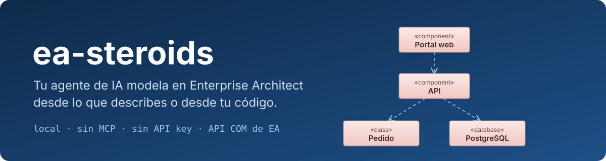
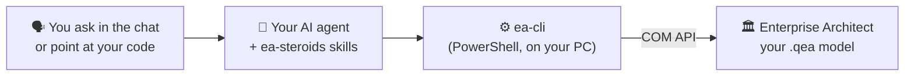

# ea-steroids

<p align="center">
  <a href="README.md">🇪🇸 Español</a> | <a href="README.en.md">🇺🇸 English</a>
</p>

<p align="center">
  
  
  
  
  <a href="LICENSE"></a>
</p>

<p align="center">
  <a href="https://github.com/kennedy122112/ea-steroids/stargazers"></a>
  
  
  
</p>

<p align="center">
  
</p>

<p align="center">
  <b>Describe your architecture or point at your code. Your AI agent models it in Enterprise Architect: real, editable packages, elements, relationships and diagrams.</b><br>
  Free and open source. Local, no MCP, no API key.
</p>

<p align="center"><sub>Independent project, not affiliated with Sparx Systems. Sparx Systems and Enterprise Architect are trademarks of their respective owners.</sub></p>

> The skills and their messages are written in Spanish, but you can talk to your agent in English: it understands and answers in your language.

---

## ✨ What it is

**ea-steroids** is a set of *skills*: instructions and tools that teach your AI assistant to work in **Sparx Enterprise Architect**. Ask in your own words and it does the work in the EA you have open:

- 🧩 **Models** component, deployment, class, use case or requirements diagrams from what you describe.
- 🔍 **Reads your code** and brings it into EA: the real architecture of a repository, or the data model of a `schema.prisma` with its multiplicities.
- 🧪 **Audits and documents** a model you already have: orphan elements, missing notes, missing traceability.
- 🔀 **Reads BPMN 2.0 processes** in EA: pools, lanes, tasks, gateways, events and flows with their types and conditions, told step by step.
- 🧬 **Derives views from a BPMN**: use cases (actors from lanes), data model (entities and states from what the process handles) and traceability back to each task, marking as an assumption whatever the BPMN doesn't say.
- 📤 **Exports** packages to XMI and diagrams to PNG.

Everything ends up as a native EA model: move it, edit it and version it like any other.

## 🧭 How it works



Your **AI agent** (Claude Code, Codex, OpenCode or Antigravity) understands the request and writes the view as a small JSON file. **ea-cli** applies it to the EA you have open through its **COM API**: nothing goes through the cloud and your model never leaves your machine. Repeating a request does not duplicate anything: it updates what already exists.

## 🧰 What you need

| You need | What for | Do I have it? |
|---|---|---|
| **Windows** | EA and its COM API only exist on Windows | — |
| **Enterprise Architect 16 or 17** | Where the model is built. Tested with 17.2 (64-bit); the 30-day trial works | You already use it |
| **An AI agent** | Understanding your request | See [step 2](#2-pick-your-ai-agent) |
| **Windows PowerShell 5.1** | Talking to EA | Comes with Windows |
| **Python 3.8 or later** (optional) | Only to generate class diagrams from Prisma | `python --version` |
| **Git** (optional) | One-command install and updates; without Git the ZIP is downloaded | `git --version` |

## 🚀 Step-by-step install

### 1. Install Enterprise Architect

If you don't have it, get the 30-day trial from **[sparxsystems.com](https://sparxsystems.com/products/ea/)**. Install it normally, **without** "Run as administrator": if EA and your agent run with different privileges, they can't see each other.

### 2. Pick your AI agent

Skip this step if you already use one:

| Agent | Where to get it |
|---|---|
| **Claude Code** | [claude.com/claude-code](https://claude.com/claude-code) |
| **Codex** | [github.com/openai/codex](https://github.com/openai/codex) |
| **OpenCode** | [opencode.ai](https://opencode.ai) |
| **Antigravity** | [antigravity.google](https://antigravity.google) |

### 3. Install ea-steroids

Open **PowerShell** (Start menu → type *PowerShell*), paste this command and press Enter:

```powershell
irm https://raw.githubusercontent.com/kennedy122112/ea-steroids/main/install.ps1 | iex
```

It downloads ea-steroids to `~/.ea-steroids` and links it into every agent you have installed. When it finishes you'll see the list of agents and **"ea-steroids instalado"**.

### 4. Ask for your first model

Open EA with a project (or let the agent create one) and, in a **new session** of your agent, write:

> *Connect to Enterprise Architect and model the architecture of an online store: the customer uses a React web portal that calls an orders API over REST; the API charges through an external payment gateway and stores data in PostgreSQL.*

The package and the diagram appear in your EA. The agent also exports it to PNG to review it with you.

**To update** later, repeat step 3 and open a new session.

## 💬 Example requests

| What you say | What you get |
|---|---|
| *"model the real architecture of this repository in EA"* | Deployment, frontend and backend component views, built from the real modules and dependencies in the code |
| *"generate the class diagrams from the Prisma schema"* | One diagram per domain with every table, its fields and types, PK/FK, and relationships with multiplicity |
| *"add a traceability view: which frontend module uses which backend module"* | A view that reuses elements from other views without duplicating them |
| *"explain the BPMN process in the Purchasing package"* | The process step by step: who does each task, what each gateway decides and on which condition, and what is sent to other participants. On request, also as a document: [example](examples/proceso-compra-bpmn.md) |
| *"from the purchasing BPMN, derive the use cases and the data model"* | A use case diagram (with «extend» and its conditions), a class diagram with states and roles, and a traceability view back to the BPMN tasks ([example](examples/derivados-compra/)) |
| *"review my requirements package in EA"* | A report of elements without traceability, without notes or orphaned, without changing anything |
| *"export the Backend package to XMI"* | The `.xmi`, ready to import into another EA instance |
| *"tidy up the diagram, the lines cross"* | Row and column positions, with no hidden boxes |

## ❓ FAQ

**Does it cost anything?**
ea-steroids is free and open source (MIT license). Enterprise Architect is a paid Sparx Systems product (with a 30-day trial that watermarks exported images), and your AI agent may have a cost depending on its plan.

**Does my data leave my computer?**
ea-steroids talks to EA on your PC and connects to no service. But your AI agent sends what you write, and whatever it reads from your code or model, to its model provider (Anthropic, OpenAI, Google, etc.). If the model contains sensitive information, check your organization's and your provider's policies.

**Does it work on Mac or Linux?**
No. Enterprise Architect and its COM API are Windows-only.

**Does it work with a server repository (SQL Server, Pro Cloud)?**
Yes, as long as it is open in your EA: ea-steroids works on whatever model EA has loaded.

**Does it delete things from my model?**
No. It only creates and updates. If something disappears from the source (for example, a Prisma field), you remove it in EA yourself.

## 🩺 Troubleshooting

| Symptom | What to do |
|---|---|
| The agent says **EA is not open** but it is | EA was started as administrator and the agent wasn't (or the other way round). Open it normally. |
| `reachable: false` (EA open but unreachable) | The agent runs in a sandbox: this happens with **Codex** in its default mode. Give it full access for these tasks. |
| The agent **doesn't know the skills** | Repeat step 3 and open a new session. |
| EA doesn't respond | It may have a dialog open (license, add-in) waiting for you: close it. |
| The diagram is too wide or lines cross | Ask the agent to lay it out by rows and columns (`grid` layout). |

## ⚠️ Limitations

- Windows only (EA and COM).
- Tested with component, deployment and class diagrams, and with enumerations. Use cases, activities, requirements and ArchiMate use the same API but haven't been tested in depth yet.
- BPMN reading was tested with processes built with EA 17.2's BPMN 2.0 profile (pools, lanes, tasks, gateways, start, end and intermediate events, sequence and message flows). Creating BPMN isn't supported yet: use [bizagi-steroids](https://github.com/kennedy122112/bizagi-steroids) and import the `.bpmn` into EA.
- It doesn't delete elements: whatever no longer exists in the source is removed by hand.
- EA's automatic layout isn't always clean on large views; the `grid` layout gives full control.

---

## 🛠️ For developers

### Other ways to install

```powershell
git clone https://github.com/kennedy122112/ea-steroids.git
cd ea-steroids
powershell -NoProfile -ExecutionPolicy Bypass -File install.ps1
```

If the repository lives outside `~/.ea-steroids`, the installer creates that link to it. `-Uninstall` removes the links without deleting files.

### Where it installs

| Agent | Path | Tested |
|---|---|---|
| Claude Code | `~/.claude/skills/ea-*` | ✅ |
| Codex | `~/.agents/skills/ea-*` | ✅ (CLI 0.164, with full access) |
| OpenCode | `~/.config/opencode/skills/ea-*` | ✅ (2.2.0) |
| Antigravity | `~/.gemini/antigravity/skills/ea-*` | Installed, not tested |

Each path is a link (junction) to the same folder: an improvement reaches every agent.

### Skills

| Skill | What for |
|---|---|
| `ea-setup` | Checks EA (version, 32/64-bit) and opens or creates a `.qea` repository |
| `ea-connect` | Connects to the open EA and picks the working package |
| `ea-model` | Builds views from natural language or code: elements, connectors, diagram and layout |
| `ea-read` | Reads, audits, documents and exports (XMI, PNG) |

### ea-cli

Also usable without an agent: `powershell -NoProfile -ExecutionPolicy Bypass -File bin/ea-cli.ps1 <command>`. All output is JSON.

| Command | What for |
|---|---|
| `status` | Is EA open? Which model? Version and bitness |
| `open -Path model.qea [-Create]` | Opens or creates a repository |
| `tree [-Package path] [-Depth 3]` | Package tree |
| `read -Package path [-Tags]` | Elements (nested ones too), connectors and diagrams of a package; `-Tags` adds tagged values |
| `bpmn -Package path [-Path doc.md]` | BPMN process: pools, lanes, typed nodes, flows with conditions and the numbered walk-through; with `-Path`, also as a Markdown document with a Mermaid diagram ([example](examples/proceso-compra-bpmn.md), in Spanish) |
| `build -Spec view.json` | Creates or updates package, elements, connectors and diagram (idempotent) |
| `image -Package path [-Diagram name] -Path out.png` | Exports a diagram |
| `export -Package path -Path out.xmi` | Exports a package to XMI 2.1 |
| `eval -Script file.ps1` | Runs your own code with `$repo` (EA's COM API) |

The spec format is in [`skills/ea-model/SKILL.md`](skills/ea-model/SKILL.md), with a complete example in [`examples/tienda-componentes.json`](examples/tienda-componentes.json). It supports references to elements in other packages (`ref`), multiplicity and roles, hiding unrelated connectors, and `auto` or `grid` layout.

### Class diagrams from Prisma

```powershell
python -I bin/prisma_a_spec.py dominios.json output-folder
```

Generates one spec per domain from a `schema.prisma`: classes with their fields, PK/FK/unique (including composite keys), enums, and every relationship with roles and multiplicity. The `dominios.json` format is documented at the top of the script. Python standard library only.

### Repository layout

| Path | Contents |
|---|---|
| `bin/ea-cli.ps1` | COM bridge to Enterprise Architect |
| `bin/prisma_a_spec.py` | Class diagram generator from Prisma |
| `skills/` | The four skills (`SKILL.md`) |
| `install.ps1` | Installer for every agent |
| `examples/`, `docs/` | Example spec and banner |

### Lessons learned about EA's API

- EA won't write files to long paths (over ~200 characters): `image` and `export` go through a short temporary path.
- EA's auto-layout shows hidden links again: `hideOtherConnectors` hides them before and after.
- 32-bit EA only registers its COM server under WOW6432Node: ea-cli relaunches itself in 32-bit PowerShell.
- Positions of an existing `DiagramObject` are integers: a PowerShell `double` fails with "specified cast is not valid".
- To hide attributes on a diagram: `DiagramObject.SetStyleEx('AttPub','0')` (and AttPri, AttPro, AttPkg, Op*).
- Two connectors between the same boxes are drawn on top of each other: `build` separates them through `DiagramLink.Geometry` (`SX`/`EX` or `SY`/`EY`).
- `Package.Elements` only returns the first level: whatever sits inside a pool, lane or component lives in `Element.Elements`.
- For BPMN, EA stores the type in tagged values: `taskType`, `gatewayType`, `eventDefinition`, `conditionExpression`. Pools and lanes are `ActivityPartition` with stereotype `Pool`/`Lane`.
- PowerShell 5.1 reads a BOM-less `.ps1` as ANSI: `eval` loads it as UTF-8 so accents aren't broken.

## 🔗 Sibling projects

- [**figma-steroids**](https://github.com/kennedy122112/figma-steroids): design in Figma Desktop from your AI agent, with no API key or MCP.
- [**bizagi-steroids**](https://github.com/kennedy122112/bizagi-steroids): describe a process and get the BPMN for Bizagi plus its Word document.

## 📄 License

[MIT](LICENSE)
