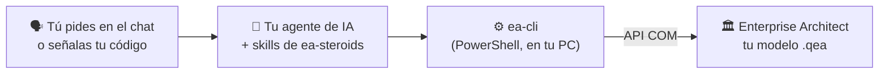

# ea-steroids

<p align="center">
  <a href="README.md">🇪🇸 Español</a> | <a href="README.en.md">🇺🇸 English</a>
</p>

<p align="center">
  
  
  
  
  <a href="LICENSE"></a>
</p>

<p align="center">
  <a href="https://github.com/kennedy122112/ea-steroids/stargazers"></a>
  
  
  
</p>

<p align="center">
  
</p>

<p align="center">
  <b>Describe tu arquitectura o señala tu código. Tu agente de IA la modela en Enterprise Architect: paquetes, elementos, relaciones y diagramas reales y editables.</b><br>
  Gratis y de código abierto. Local, sin MCP y sin API key.
</p>

<p align="center"><sub>Proyecto independiente, no afiliado a Sparx Systems. Sparx Systems y Enterprise Architect son marcas de sus respectivos titulares.</sub></p>

---

## ✨ Qué es

**ea-steroids** es un conjunto de *skills*: paquetes de instrucciones y herramientas que le enseñan a tu asistente de IA a trabajar en **Sparx Enterprise Architect**. Le pides lo que necesitas con tus palabras y lo hace en tu EA abierto:

- 🧩 **Modela** diagramas de componentes, despliegue, clases, casos de uso o requisitos a partir de lo que describes.
- 🔍 **Lee tu código** y lo lleva a EA: la arquitectura real de un repositorio o el modelo de datos de un `schema.prisma`, con sus multiplicidades.
- 🧪 **Audita y documenta** un modelo que ya tienes: elementos huérfanos, sin notas, sin trazabilidad.
- 🔀 **Lee procesos BPMN 2.0** de EA: pools, carriles, tareas, compuertas, eventos y flujos con sus tipos y condiciones, contados paso a paso.
- 📤 **Exporta** paquetes a XMI y diagramas a PNG.

Todo queda como modelo nativo de EA: lo puedes mover, editar y versionar como cualquier otro.

## 🧭 Cómo funciona



Tu **agente de IA** (Claude Code, Codex, OpenCode o Antigravity) entiende lo que pides y escribe la vista como un pequeño archivo JSON. **ea-cli** lo aplica en el EA que tienes abierto por su **API COM**: no pasa por la nube y tu modelo no sale de tu equipo. Repetir un pedido no duplica nada: actualiza lo que ya existe.

## 🧰 Qué necesitas

| Necesitas | Para qué | ¿Lo tengo? |
|---|---|---|
| **Windows** | EA y su API COM solo existen en Windows | — |
| **Enterprise Architect 16 o 17** | Donde se crea el modelo. Probado con 17.2 (64 bits); la prueba de 30 días sirve | Ya lo usas |
| **Un agente de IA** | Entender tu pedido | Ver el [paso 2](#2-elige-tu-agente-de-ia) |
| **Windows PowerShell 5.1** | Hablar con EA | Viene con Windows |
| **Python 3.8 o superior** (opcional) | Solo para generar diagramas de clases desde Prisma | `python --version` |
| **Git** (opcional) | Instalar y actualizar con un comando; sin Git se descarga el ZIP | `git --version` |

## 🚀 Instalación paso a paso

### 1. Instala Enterprise Architect

Si no lo tienes, descarga la prueba de 30 días desde **[sparxsystems.com](https://sparxsystems.com/products/ea/)**. Instálalo normal, **sin** "Ejecutar como administrador": si EA y tu agente corren con permisos distintos, no se ven.

### 2. Elige tu agente de IA

Si ya usas uno de estos, sáltate este paso:

| Agente | Dónde conseguirlo |
|---|---|
| **Claude Code** | [claude.com/claude-code](https://claude.com/claude-code) |
| **Codex** | [github.com/openai/codex](https://github.com/openai/codex) |
| **OpenCode** | [opencode.ai](https://opencode.ai) |
| **Antigravity** | [antigravity.google](https://antigravity.google) |

### 3. Instala ea-steroids

Abre **PowerShell** (menú Inicio → escribe *PowerShell*), copia este comando y pulsa Enter:

```powershell
irm https://raw.githubusercontent.com/kennedy122112/ea-steroids/main/install.ps1 | iex
```

Lo descarga en `~/.ea-steroids` y lo enlaza en cada agente que tengas instalado. Al terminar verás la lista de agentes y **"ea-steroids instalado"**.

### 4. Pide tu primer modelo

Abre EA con un proyecto (o deja que el agente cree uno) y, en una **sesión nueva** de tu agente, escribe:

> *Conecta con Enterprise Architect y modela la arquitectura de una tienda en línea: el cliente usa un portal web en React, que llama por REST a una API de pedidos; la API cobra con una pasarela de pagos externa y guarda en PostgreSQL.*

Verás aparecer el paquete y el diagrama en tu EA. El agente también lo exporta a PNG para revisarlo contigo.

**Para actualizar** más adelante, repite el paso 3 y abre una sesión nueva.

## 💬 Ejemplos de pedidos

| Lo que dices | Lo que obtienes |
|---|---|
| *"modela en EA la arquitectura real de este repositorio"* | Vistas de despliegue, de componentes del frontend y del backend, sacadas de los módulos y dependencias reales del código |
| *"genera los diagramas de clases desde el schema de Prisma"* | Un diagrama por dominio con cada tabla, sus campos y tipos, PK/FK y las relaciones con su multiplicidad |
| *"agrega una vista de trazabilidad: qué módulo del frontend usa qué módulo del backend"* | Una vista que reutiliza los elementos de otras vistas, sin duplicarlos |
| *"explícame el proceso BPMN del paquete Compras"* | El proceso paso a paso: quién hace cada tarea, qué decide cada compuerta y con qué condición, y qué se manda a otros participantes |
| *"revisa mi paquete de requisitos en EA"* | Un informe con elementos sin trazabilidad, sin notas o huérfanos, sin modificar nada |
| *"exporta el paquete Backend a XMI"* | El `.xmi` listo para importar en otra instancia de EA |
| *"reacomoda el diagrama, que se cruzan las líneas"* | Posiciones por fila y columna, sin cajas tapadas |

## ❓ Preguntas frecuentes

**¿Cuesta algo?**
ea-steroids es gratuito y de código abierto (licencia MIT). Enterprise Architect es un producto de pago de Sparx Systems (con prueba de 30 días, que pone marca de agua en las imágenes exportadas), y tu agente de IA puede tener costo según su plan.

**¿Mis datos salen de mi computadora?**
ea-steroids habla con EA en tu PC y no se conecta a ningún servicio. Pero tu agente de IA envía lo que escribes, y lo que lee de tu código o de tu modelo, al proveedor de su modelo (Anthropic, OpenAI, Google, etc.). Si el modelo tiene información sensible, revisa las políticas de tu organización y de tu proveedor.

**¿Funciona en Mac o Linux?**
No. Enterprise Architect y su API COM son de Windows.

**¿Funciona con un repositorio en servidor (SQL Server, Pro Cloud)?**
Sí, mientras lo tengas abierto en tu EA: ea-steroids trabaja sobre el modelo que EA tiene cargado.

**¿Borra cosas de mi modelo?**
No. Solo crea y actualiza. Si algo se quita del origen (por ejemplo, un campo de Prisma), lo quitas tú en EA.

## 🩺 Solución de problemas

| Síntoma | Qué hacer |
|---|---|
| El agente dice que **EA no está abierto** y sí lo está | EA se abrió como administrador y el agente no (o al revés). Ábrelo normal. |
| `reachable: false` (EA abierto pero inalcanzable) | El agente corre en un sandbox: pasa con **Codex** en su modo por defecto. Dale acceso completo para estas tareas. |
| El agente **no conoce las skills** | Repite el paso 3 y abre una sesión nueva. |
| EA no responde | Puede tener abierta una ventana (licencia, add-in) esperando tu respuesta: ciérrala. |
| El diagrama queda muy ancho o con cruces | Pídele al agente que lo reacomode por filas y columnas (layout `grid`). |

## ⚠️ Limitaciones

- Solo Windows (EA y COM).
- Probado con diagramas de componentes, despliegue y clases, y con enumeraciones. Casos de uso, actividades, requisitos y ArchiMate usan la misma API, pero todavía no se han probado a fondo.
- La lectura BPMN se probó con procesos hechos con el perfil BPMN 2.0 de EA 17.2 (pools, carriles, tareas, compuertas, eventos de inicio, fin e intermedios, flujos de secuencia y de mensaje). Crear BPMN todavía no está soportado: para eso usa [bizagi-steroids](https://github.com/kennedy122112/bizagi-steroids) e importa el `.bpmn` en EA.
- No borra elementos: lo que ya no existe en el origen se quita a mano.
- El layout automático de EA no siempre queda limpio en vistas grandes; el layout `grid` da control total.

---

## 🛠️ Para desarrolladores

### Otras formas de instalar

```powershell
git clone https://github.com/kennedy122112/ea-steroids.git
cd ea-steroids
powershell -NoProfile -ExecutionPolicy Bypass -File install.ps1
```

Si el repositorio queda fuera de `~/.ea-steroids`, el instalador crea ese enlace hacia él. `-Uninstall` quita los enlaces sin borrar archivos.

### Dónde se instala

| Agente | Ruta | Probado |
|---|---|---|
| Claude Code | `~/.claude/skills/ea-*` | ✅ |
| Codex | `~/.agents/skills/ea-*` | ✅ (CLI 0.164, con acceso completo) |
| OpenCode | `~/.config/opencode/skills/ea-*` | ✅ (2.2.0) |
| Antigravity | `~/.gemini/antigravity/skills/ea-*` | Instalado, sin probar |

Cada ruta es un enlace (junction) a la misma carpeta: una mejora llega a todos los agentes.

### Skills

| Skill | Para qué |
|---|---|
| `ea-setup` | Comprueba EA (versión, 32/64 bits) y abre o crea un repositorio `.qea` |
| `ea-connect` | Conecta con el EA abierto y elige el paquete de trabajo |
| `ea-model` | Crea vistas desde lenguaje natural o código: elementos, conectores, diagrama y layout |
| `ea-read` | Lee, audita, documenta y exporta (XMI, PNG) |

### ea-cli

Se usa también sin agente: `powershell -NoProfile -ExecutionPolicy Bypass -File bin/ea-cli.ps1 <comando>`. Toda salida es JSON.

| Comando | Para qué |
|---|---|
| `status` | ¿EA abierto?, ¿qué modelo?, versión y bits |
| `open -Path modelo.qea [-Create]` | Abre o crea un repositorio |
| `tree [-Package ruta] [-Depth 3]` | Árbol de paquetes |
| `read -Package ruta [-Tags]` | Elementos (también los anidados), conectores y diagramas de un paquete; `-Tags` suma los tagged values |
| `bpmn -Package ruta` | Proceso BPMN: pools, carriles, nodos con su tipo, flujos con condiciones y el recorrido numerado |
| `build -Spec vista.json` | Crea o actualiza paquete, elementos, conectores y diagrama (idempotente) |
| `image -Package ruta [-Diagram nombre] -Path salida.png` | Exporta un diagrama |
| `export -Package ruta -Path salida.xmi` | Exporta un paquete a XMI 2.1 |
| `eval -Script archivo.ps1` | Ejecuta código propio con `$repo` (la API COM de EA) |

El formato del spec está en [`skills/ea-model/SKILL.md`](skills/ea-model/SKILL.md), y hay un ejemplo completo en [`examples/tienda-componentes.json`](examples/tienda-componentes.json). Incluye referencias a elementos de otros paquetes (`ref`), multiplicidad y roles, ocultar conectores ajenos y layout `auto` o `grid`.

### Diagramas de clases desde Prisma

```powershell
python -I bin/prisma_a_spec.py dominios.json carpeta-salida
```

Genera un spec por dominio desde un `schema.prisma`: clases con sus campos, PK/FK/unique (también la clave compuesta), enum y cada relación con roles y multiplicidad. El formato de `dominios.json` está al inicio del script. Solo usa la biblioteca estándar de Python.

### Estructura del repo

| Ruta | Contenido |
|---|---|
| `bin/ea-cli.ps1` | Puente COM con Enterprise Architect |
| `bin/prisma_a_spec.py` | Generador de diagramas de clases desde Prisma |
| `skills/` | Las cuatro skills (`SKILL.md`) |
| `install.ps1` | Instalador para todos los agentes |
| `examples/`, `docs/` | Spec de ejemplo y banner |

### Notas de la API de EA aprendidas

- EA no escribe archivos en rutas largas (más de ~200 caracteres): `image` y `export` pasan por un temporal corto.
- El auto-layout de EA vuelve a mostrar los enlaces ocultos: `hideOtherConnectors` los oculta antes y después.
- EA de 32 bits solo registra su COM en WOW6432Node: ea-cli se relanza en PowerShell de 32 bits.
- Las posiciones de un `DiagramObject` existente son enteros: un `double` de PowerShell falla con «conversión no válida».
- Para ocultar atributos en un diagrama: `DiagramObject.SetStyleEx('AttPub','0')` (y AttPri, AttPro, AttPkg, Op*).
- `Package.Elements` solo trae el primer nivel: lo que va dentro de un pool, un carril o un componente está en `Element.Elements`.
- En BPMN, EA guarda el tipo en tagged values: `taskType`, `gatewayType`, `eventDefinition`, `conditionExpression`. Los pools y carriles son `ActivityPartition` con estereotipo `Pool`/`Lane`.
- PowerShell 5.1 lee un `.ps1` sin BOM como ANSI: `eval` lo carga como UTF-8 para no romper las tildes.

## 🔗 Proyectos hermanos

- [**figma-steroids**](https://github.com/kennedy122112/figma-steroids): diseña en Figma Desktop desde tu agente de IA, sin API key ni MCP.
- [**bizagi-steroids**](https://github.com/kennedy122112/bizagi-steroids): describe un proceso y obtén el BPMN para Bizagi y su documento Word.

## 📄 Licencia

[MIT](LICENSE)
