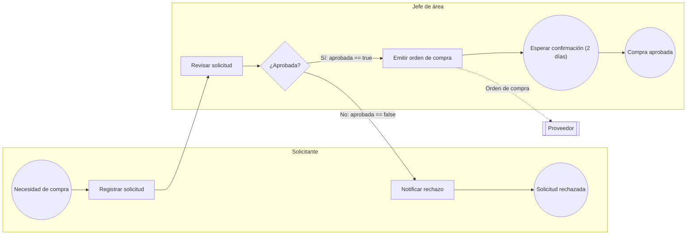

# Proceso de compra

Proceso BPMN leído de Enterprise Architect (paquete `Model/Proceso de compra`) con ea-steroids.

## Participantes

| Participante (pool) | Responsables (carriles) |
|---|---|
| Empresa | Solicitante, Jefe de área |
| Proveedor | — (externo) |

## Recorrido

| N° | Responsable | Paso | Tipo | Sigue |
|---|---|---|---|---|
| 1 | Solicitante | Necesidad de compra | Inicio | 2. Registrar solicitud |
| 2 | Solicitante | Registrar solicitud | Tarea de usuario | 3. Revisar solicitud |
| 3 | Jefe de área | Revisar solicitud | Tarea de usuario | 4. ¿Aprobada? |
| 4 | Jefe de área | ¿Aprobada? | Compuerta exclusiva | 5. Emitir orden de compra [Sí: aprobada == true] 6. Notificar rechazo [No: aprobada == false] |
| 5 | Jefe de área | Emitir orden de compra | Tarea de servicio | 7. Esperar confirmación (2 días) |
| 6 | Solicitante | Notificar rechazo | Tarea de envío | 8. Solicitud rechazada |
| 7 | Jefe de área | Esperar confirmación (2 días) | Evento intermedio (temporizador) | 9. Compra aprobada |
| 8 | Solicitante | Solicitud rechazada | Fin | — |
| 9 | Jefe de área | Compra aprobada | Fin | — |

## Decisiones

**4. ¿Aprobada?** (Compuerta exclusiva)

- **Sí** → Emitir orden de compra — condición: `aprobada == true`
- **No** → Notificar rechazo — condición: `aprobada == false`

## Mensajes con otros participantes

- Emitir orden de compra → **Proveedor**: Orden de compra

## Diagrama

